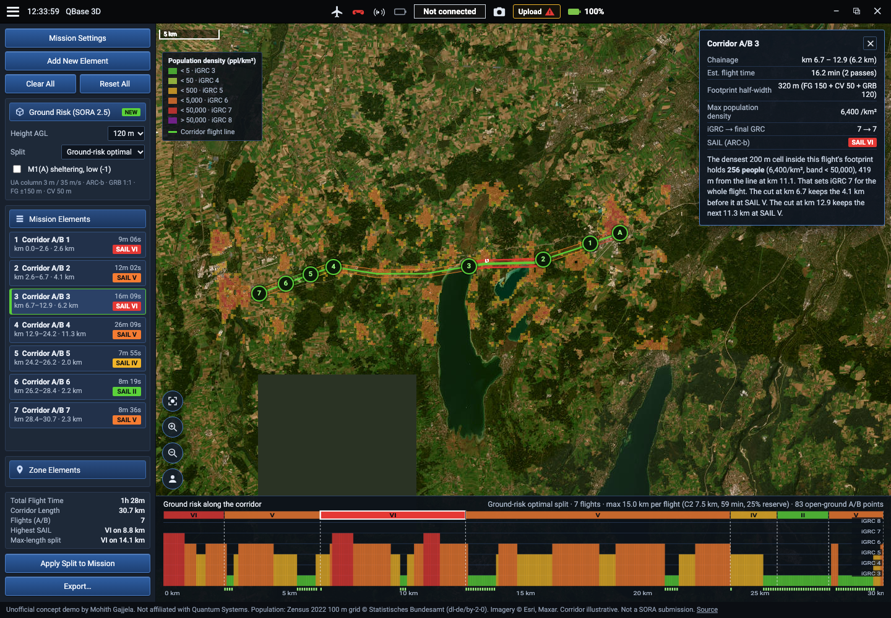

# Ground Risk (SORA 2.5) for QBase 3D A/B corridor missions

**Live demo:** https://mohith26.github.io/qbase-ground-risk/ · unofficial concept, not affiliated with Quantum Systems. Civil mapping use (Trinity Pro); not a SORA submission.

QBase 3D's A/B missions are what make long corridor mapping with Trinity Pro possible ("paving the way to BVLOS flights"). A BVLOS corridor job in the EU specific category needs a SORA, and under SORA 2.5 each flight's intrinsic ground risk class is set by the **highest population density anywhere in its operational volume plus ground risk buffer**. So where you split the corridor into A/B flights decides how many kilometres are flown at a higher SAIL: one badly placed cut drags a long rural stretch into the SAIL of the one village it touches. **This panel computes SORA 2.5 ground risk along the corridor from the real Zensus 2022 population grid and finds the exactly optimal A/B split: fewest kilometres at the highest SAIL, then the next, then fewest flights, within Trinity Pro's endurance and C2 range and with every take-off/landing in open ground.**



## How it works

1. **Population:** Zensus 2022 100 m grid (Destatis open data), aggregated to the 200 m grid SORA 2.5 suggests for flights at or below 500 ft AGL (`scripts/extract.mjs`, EPSG:3035).
2. **Footprint:** every 100 m of chainage, the maximum density of any 200 m cell touched by a disc of radius flight-geography half-width (150 m) + contingency volume (50 m) + ground risk buffer (1:1 rule = height AGL).
3. **iGRC / GRC / SAIL:** SORA 2.5 iGRC table, column max dimension 3 m / max speed 35 m/s (Trinity Pro: 2.394 m wingspan, 17 m/s cruise); optional M1(A) sheltering at low robustness (-1); SAIL from the SORA 2.5 matrix for ARC-b.
4. **Flight limits:** C2 range 7.5 km with the ground station at the segment midpoint (15 km), endurance 59 min (export default) with 25% reserve, 2 mapping passes and 4 min VTOL overhead (21 km, so C2 binds); flights at least 2 km; A/B points must have no inhabited 200 m cell within 300 m.
5. **Optimal split:** dynamic programming over the 309 chainage points with a lexicographic cost vector (km at SAIL VI, V, IV, III, II, then number of flights). A flight's cost depends only on its own endpoints, and lexicographic order is compatible with addition, so the DP is exactly optimal; a randomized test checks it against brute-force enumeration on 300 small profiles.

## Results (from `data/results.json`, `scripts/evaluate.mjs`)

Illustrative 30.7 km corridor roughly along the A96 from Gilching to Landsberg am Lech, 120 m AGL, no mitigations:

| Split | Flights | Highest SAIL | km at highest SAIL | km at SAIL II |
|---|---|---|---|---|
| Max length (fly as far as limits allow) | 3 | VI | 14.1 | 0 |
| Ground-risk optimal | 7 | VI | **8.8** | 2.2 |

The optimal plan cuts the kilometres flown at SAIL VI by 38% at the cost of four more A/B legs. The result is the same at 60 and 90 m AGL; with M1(A) the whole profile drops one SAIL (worst V, still 8.8 km vs 14.1 km).

## The app

QBase 3D layout: title bar with link/aircraft status, planning panel (Mission Settings, Mission Elements, Zone Elements, totals), imagery map with the population layer (SORA density bands), corridor footprints coloured by SAIL, numbered A/B points, and a ground-risk profile along the chainage. Click a flight (list, map or profile) for its worst cell, iGRC, GRC and SAIL and why the neighbouring cuts sit where they are. Change height AGL, toggle M1(A), compare with the max-length split, apply the split to the mission (persisted), export JSON / CSV / GeoJSON. Deep links (`#h=90&m1a=1&f=3`), keyboard (`[` `]` `1-9` `m` `o` `g` `e` `Esc`), loading and error states.

## Honest limitations

- The corridor is hand-placed along the A96 axis through village centres, so it is denser than a real infrastructure corridor would be; it is a demonstration of the method, not of a real job.
- Static residential population only (Zensus counts where people live). SORA 2.5 lets authorities require other maps; daytime population, roads and assemblies are not modelled. Adjacent-area and containment requirements (Step #8) are not computed.
- ARC-b is assumed everywhere; real airspace (e.g. near Oberpfaffenhofen) can raise the air risk class and the SAIL.
- Whether separate SAILs per flight are acceptable as separate operations, or the whole campaign is assessed at its worst flight, is the competent authority's call. The planner's value in the second case is still knowing exactly which kilometres drive the SAIL.
- Flight-time model is simple (fixed cruise, no wind); QBase's own simulation would replace it.

## Prior art and what is new

SORA iGRC calculators and population maps exist (JARUS SORA 2.5 Annex F/H; the Norwegian CAA's SORA 2.5 calculator; BAZL's Swiss SORA 2.5 population map; skyzr wingman computes ground risk for an uploaded flight plan). QBase 3D advertises wind/battery simulation, terrain following and automated risk checks, but I found no ground-risk/SORA support. I did not find any planner that chooses A/B split points to minimise the kilometres flown at high SAIL.

## Run

```
# optional: rebuild the population extract (downloads ~18 MB from Destatis)
curl -LO https://www.destatis.de/static/DE/zensus/gitterdaten/Zensus2022_Bevoelkerungszahl.zip && unzip Zensus2022_Bevoelkerungszahl.zip
node scripts/extract.mjs Zensus2022_Bevoelkerungszahl_100m-Gitter.csv
node scripts/evaluate.mjs      # data/results.json
node --test test/*.test.mjs    # 13 tests
python3 -m http.server         # open http://localhost:8000
```

Data: Zensus 2022 © Statistisches Bundesamt (Destatis), Datenlizenz Deutschland Namensnennung 2.0. Imagery © Esri, Maxar. Aircraft figures from the public Trinity Pro datasheet.
